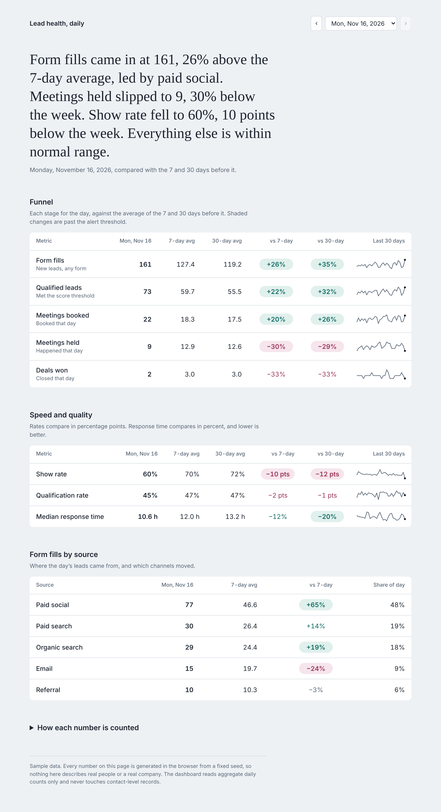

# Lead Health – Daily

A one-page morning dashboard that tells marketing and sales leaders whether yesterday’s lead funnel looked normal, and if not, exactly where it moved.

**[Open the live demo](#)** · Runs entirely in the browser on generated sample data.

## The problem

Our CMO and sales leadership wanted one place to check lead health each morning: how yesterday compared with the last week and the last month, from form fill all the way to closed deals.

Before this existed, I pulled those numbers from the CRM by hand every day and wrote up the analysis. That took 45 to 90 minutes a day, the numbers were only as accurate as my manual entry, and leadership had to wait on me to know how the day went.

## What I built

The production version is a Claude Artifact connected to HubSpot. Each morning it shows:

- **A plain-language summary** at the top, so leaders can read the day in ten seconds without scanning tables.
- **The funnel**: form fills, qualified leads, meetings booked, meetings held, and deals won, each against the 7- and 30-day averages, with a 30-day trend line.
- **Speed and quality**: show rate, qualification rate, and median lead response time.
- **Form fills by source**, so a spike or drop can be traced to the channel that caused it.
- **Alerts**: changes past a set threshold are shaded, green for better and red for worse.

I also own the metric definitions. They’re written into the dashboard itself, so everyone reads each number the same way. That turned out to matter as much as the numbers.

## Results

- Saves **5 to 7 hours a week** of manual pulling and analysis.
- Leadership starts the day from **one shared view** instead of waiting for a report.

## Data and privacy

This was built for a health company, so privacy shaped the design from the start.

- **Aggregate counts only.** The dashboard reads daily totals and never touches contact-level records, so no PHI or PII is ever in it.
- **One shared view.** It runs on a single CRM view, so every leader sees the same numbers regardless of what their own account can access.
- **This repo uses no real data.** Every number is generated in the browser from a fixed seed. Nothing here describes real people or a real company.

## How this demo works

It’s a single `index.html` file with no build step and no dependencies beyond a Google Font.

| Part | What it does |
|---|---|
| `loadDays()` | The data layer. In production it pulls daily aggregate counts from the CRM; here it calls `generateSampleDays()`. |
| `COUNT_METRICS`, `RATE_METRICS` | Each metric’s label, calculation, and written definition, in one place. |
| `judge()` | Decides whether a change is normal, better, or worse, and whether it crosses the alert threshold. |
| `buildBrief()` | Writes the summary sentence. In production the morning note is drafted with Claude; this demo uses rules so it runs without an API key. |

A few choices worth calling out:

- **Rates are pooled, not averaged.** The 7-day show rate is total meetings held divided by total scheduled, so a slow Sunday doesn’t count as much as a busy Tuesday.
- **Small counts don’t trigger alerts.** Two deals instead of three is a 33% drop and also noise, so counts must move by at least 3 before they’re flagged.
- **Lower is better for response time.** The alert colors follow what’s good for the business, not which way the number moved.

## Run it

Open `index.html` in a browser, or view it on GitHub Pages. Use the day picker to step back through the sample period.

## Adapt it

1. Replace `generateSampleDays()` with a function that returns your own daily aggregates in the same shape.
2. Edit the metric lists to match your funnel stages and definitions.
3. Set the alert thresholds in `CONFIG`.

## About

Built by Naomi Nakashima. I run marketing operations, CRM, and lifecycle marketing, and I build AI tools that take manual work off the team.
